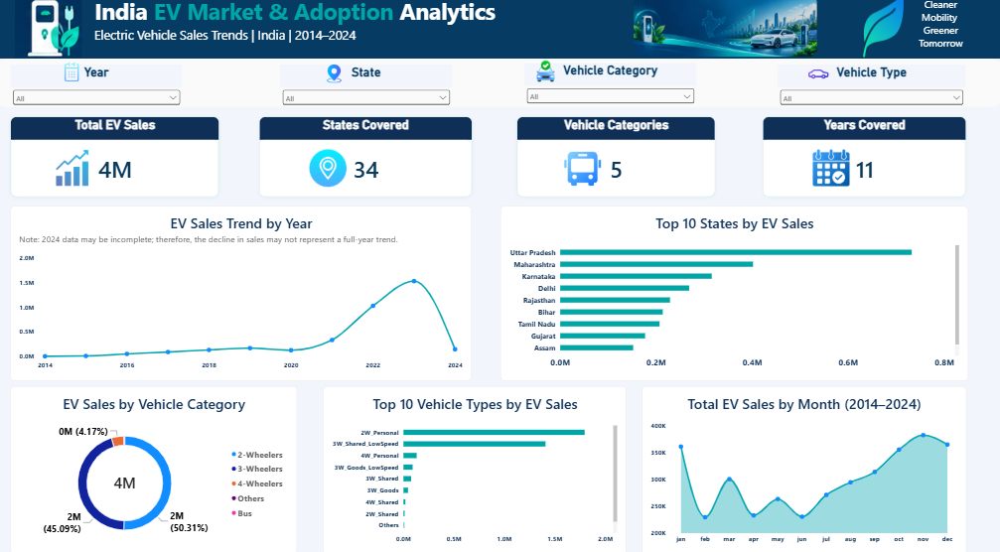

# Electric Vehicle Market & Adoption Analytics — India

## Project Overview

This project explores electric vehicle (EV) sales patterns across Indian states, years, vehicle categories, and vehicle types using Python, Pandas, MySQL, and Power BI.

The goal is to transform raw data into meaningful insights through data cleaning, SQL analysis, and interactive visualizations.

## Project Objectives

- Analyze EV sales trends over time.
- Compare reported EV sales quantities across Indian states.
- Understand sales distribution across vehicle categories and types.
- Inspect, clean, and validate data using Python Pandas.
- Use SQL queries to answer business questions.
- Build an interactive Power BI dashboard for data exploration.

## Tools & Technologies

- Python
- Pandas
- MySQL
- Power BI
- Git and GitHub

## Project Workflow

1. **Data Inspection:** Examined dataset structure, columns, missing values, duplicates, and sales patterns.
2. **Data Cleaning:** Standardized data types, parsed dates, validated sales quantities, and exported the cleaned dataset.
3. **SQL Analysis:** Queried EV sales by year, state, vehicle category, and vehicle type.
4. **Power BI Dashboard:** Created KPI cards, slicers, trend charts, and sales comparison visuals.
5. **Documentation:** Recorded the workflow, tools, and limitations of the analysis.

## Dashboard Preview



## Project Progress

- [x] Dataset inspection
- [x] Data cleaning and validation using Python Pandas
- [x] SQL analysis with 20 business-focused queries
- [x] Interactive Power BI dashboard
- [x] Dashboard screenshot uploaded to GitHub
- [ ] Final business insights and conclusions

## Project Status

Core analysis and dashboard completed. Final documentation and insights are in progress.

## Dataset

The dataset contains reported electric vehicle sales information across Indian states, vehicle categories, and vehicle types from 2014 to 2024.

Raw and cleaned CSV files are stored locally and excluded from GitHub while redistribution permissions are being verified.

**Note:** The available 2024 data may be incomplete. Comparisons involving 2024 should therefore be interpreted cautiously.

## Key Analysis Areas

- Annual EV sales trends
- State-wise EV sales comparison
- Vehicle category sales distribution
- Top vehicle types by reported sales
- Monthly sales patterns
- Total reported EV sales and dataset coverage

## Project Structure

```text
EV_Market_Analytics/
├── data/
│   ├── raw/
│   └── processed/
├── scripts/
│   ├── 01_data_inspection.py
│   └── 02_data_cleaning.py
├── sql/
│   └── 01_ev_sales_analysis.sql
├── powerbi/
│   └── ev_dashboard.png
├── notebooks/
├── .gitignore
└── README.md